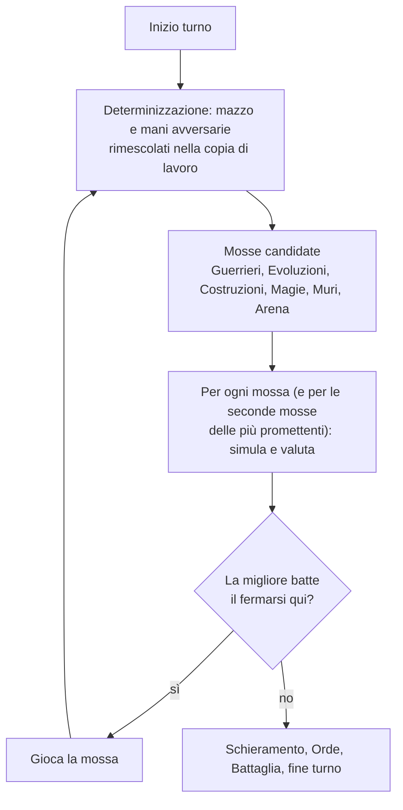
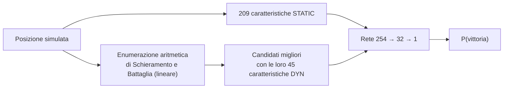

# Bot Factory

Mini-progetto autonomo all'interno di Barbacane, nello stesso spirito della [Card Factory](../card_factory/README.md). Allena e misura i Bot: il codice che gira in partita (il turno del Bot, la valutazione delle posizioni, i pesi appresi) sta in `engine/bot/`, mentre qui vive tutto ciò che produce quei pesi e ne verifica la forza. Il server non importa nulla da questa cartella.

```
engine/bot/
  play.py           ← il turno del Bot: mosse candidate, ricerca, Schieramento, Battaglia, i tre livelli (PROFILES)
  eval.py           ← caratteristiche del tavolo e modelli di valutazione (lineare + rete)
  weights.json      ← i pesi appresi (~70 KB): l'unico output di questo progetto che serve al gioco
bot_factory/
  train.py          ← CLI: selfplay, fit, arena, prior
  requirements.txt  ← numpy, scipy (solo in locale: il server valuta in Python puro)
  lab/              ← dati (.npz) e pesi intermedi dell'addestramento, non versionata
```

---

## Come ragiona il Bot

A ogni mossa il Bot prova le azioni disponibili su una copia dello stato, guarda una seconda Azione per le più promettenti e giudica le posizioni ottenute *come se il turno finisse lì*: miglior Schieramento e Battaglia possibili, poi una stima della probabilità di vincere. Gioca la mossa col valore più alto solo se batte quello del fermarsi, e ripete finché non gli conviene più.



Le carte che il Bot non può vedere vengono rimescolate prima di ogni ricerca (una determinizzazione per mossa), quindi non sfrutta informazioni nascoste. Se una sua Magia aspetta la risposta di un umano (Magiscudo, Malcomune), il turno si ferma e riprende dalla stessa posizione quando l'umano ha risposto.

### La funzione di valore

La posizione a fine turno (dopo Schieramento e Battaglia, prima della pesca) è descritta da 254 caratteristiche: Vite e Muri di ciascuno, Guerrieri in campo per carta e per Specie, Costruzioni complete e non, mano e Mana del turno dopo, e il bilancio dei Danni, cioè quanto posso colpire io e quanto può colpire il vicino al turno dopo. Il target è la probabilità di vincere la partita.

I modelli sono due, addestrati sugli stessi dati:

- **Regressione logistica**, lineare nelle caratteristiche.
- **MLP 254 → 32 → 1** (ReLU), che coglie le interazioni che il lineare non vede: quanto pesa un Bastione scoperto dipende dalle Vite rimaste, per esempio.

Servono entrambi per un motivo di costo. Lo Schieramento è la parte cara: con *n* Guerrieri ci sono 3ⁿ disposizioni, più le Orde da attivare e il bersaglio. Le caratteristiche si dividono quindi in **STATIC** (209, indipendenti dalla disposizione) e **DYN** (45: Vite e Muri dell'avversario dopo la Battaglia, esposizione dei propri Bastioni, forze in campo, Orde attive). Con un modello lineare il punteggio è la somma dei due contributi, e quello STATIC è una costante: le disposizioni si enumerano in pura aritmetica, senza copiare lo stato né chiamare il motore. Lo spazio si pota con la struttura delle regole, perché in Battaglia contano solo i massimi:

- in Avanscoperta bastano nessuno, un solo Guerriero non dominato, o la coppia (miglior ATT, miglior GIT);
- per la difesa decidono i due Guerrieri con più DIF e i due con più GIT, da distribuire sui due Bastioni;
- le Orde sono configurazioni che vincolano le zone, provate una Specie alla volta.

Il lineare propone i candidati migliori (3 per ogni posizione provata durante la ricerca, 12 per lo Schieramento vero) e la rete sceglie tra quelli.



La rete viene valutata in modo incrementale: lo strato nascosto di una posizione si ricava per differenza da quello di una posizione vicina della stessa ricerca (cambiano poche caratteristiche), e i contributi DYN sono in cache per tratto (avversario, difesa, forze). Il risultato coincide con la valutazione da zero fino all'errore numerico, e ha portato il turno di self-play da 356 a 96 ms.

---

## Setup

Dall'interno di `bot_factory/`, o con il tuo ambiente conda attivo:

```bash
pip install -r requirements.txt
```

Dipendenze: `numpy`, `scipy`. A differenza della Card Factory, i comandi si lanciano **dalla radice del progetto** (`python -m bot_factory.train ...`), perché importano l'engine.

---

## Pipeline

Un giro di addestramento è self-play → fit → arena, e dura circa 20 minuti su 12 core. Si ripete finché i nuovi pesi smettono di battere i vecchi.

### Step 1 — Self-play

```bash
python -m bot_factory.train selfplay --games 4000 --out bot_factory/lab/d1.npz
python -m bot_factory.train selfplay --games 4000 --out bot_factory/lab/d2.npz --league bot_factory/lab/w1.json
# --weights: pesi con cui gioca (default: engine/bot/weights.json); --league: pesi di giri precedenti, come avversari
```

Gioca partite a 2, 3 e 4 giocatori (70/15/15) su tutti i core e registra ogni posizione di fine turno con le sue 254 caratteristiche. L'etichetta è l'esito della partita: 1 per chi vince, 0 per gli altri; una partita che non finisce entro 240 turni vale 0 per tutti, così il modello non impara che murarsi a oltranza conviene.

Gli avversari non sono tutti copie del Bot: circa il 15% usa i pesi dei giri precedenti (`--league`), il 25% lo stesso modello con una preferenza aggiunta ai logit (gli **stili** in `STYLES`: aggressivo, difensivo, costruttore, a caccia di Orde), il resto sono copie di sé stesso con rumore crescente, le più rumorose in minoranza. Senza varietà il Bot migliora contro se stesso e si ferma lì (vedi sotto).

---

### Step 2 — Fit

```bash
python -m bot_factory.train fit --data bot_factory/lab/d3.npz bot_factory/lab/d2.npz bot_factory/lab/d1.npz --out bot_factory/lab/w4.json
python -m bot_factory.train fit --data bot_factory/lab/d1.npz --out bot_factory/lab/w1.json --hidden 0   # solo il lineare
```

Addestra i due modelli sulle posizioni degli ultimi 3–4 giri: regressione logistica con L-BFGS (L2 = 1e-4) e MLP in numpy con Adam (batch 512, si tiene l'epoca con la log-loss migliore su un 10% di posizioni tenuto da parte). Stampa la log-loss di controllo di entrambi e scrive un unico JSON; i pesi sono salvati **per nome di caratteristica**, quindi un file di pesi resta utilizzabile anche dopo aver aggiunto carte o caratteristiche (quelle nuove partono da zero).

---

### Step 3 — Arena

```bash
python -m bot_factory.train arena bot_factory/lab/w4.json engine/bot/weights.json --games 330
python -m bot_factory.train arena hard normal --games 330 --players 4      # un A contro tre B
```

Fa giocare A contro B a posti alternati, su tutti i core, e stampa percentuale di vittorie e tempo per turno. A e B sono un file di pesi (giocato con la ricerca del Difficile), un livello (`easy`, `normal`, `hard`), un livello con un altro rumore (`normal@0.6`) oppure `random`, un giocatore che sceglie a caso tra le mosse utili. Con 330 partite l'errore standard è circa 2,7 punti: differenze di uno o due punti tra giri sono rumore.

Quando i nuovi pesi battono i vecchi se ne continua con un altro giro; quando restano intorno al 50% si copiano i migliori in `engine/bot/weights.json`.

---

### Step 4 — Taratura dei livelli

```bash
python -m bot_factory.train arena normal@0.6 easy --games 330
python -m bot_factory.train arena easy random --games 330
```

I tre livelli di `PROFILES` (in `engine/bot/play.py`) usano gli stessi pesi e differiscono per ampiezza di ricerca e per un rumore gaussiano sul valore delle mosse. Il rumore è espresso in logit *di questo modello*, quindi dopo un riaddestramento va ricontrollato con i confronti qui sopra, puntando alla scala del grafico nella sezione Livelli.

**Manutenzione:** quando cambiano le carte o le regole, i vecchi `.npz` non servono più (le colonne dipendono dalle carte), ma i pesi sì: si riparte con `selfplay --weights` dai pesi attuali. Se cambia una regola di Battaglia, un effetto Orda o il Fossato va cambiato anche in `engine/bot/eval.py`, che ne ricalcola l'aritmetica senza passare dal motore. `prior` scrive invece pesi a mano (solo lineari), per ripartire da zero.

---

## Livelli

| | Facile | Normale | Difficile |
|---|---|---|---|
| Ricerca | un'azione alla volta | due azioni, 3 × 4 alternative | due azioni, 8 × 8 alternative |
| Rumore sul giudizio (logit) | 1,8 | 0,5 | 0 |
| Magie | solo le senza bersagli complessi | tutte | tutte |
| Arena, Cardo + Decumano | no | sì | sì |
| Magiscudo in risposta | 30% delle volte | 70% | sempre |

L'imprecisione è rumore casuale sul valore delle mosse, non una regola sbagliata: ogni partita sbaglia in punti diversi. Percentuale di vittorie contro il livello sotto (330–440 partite a 2 giocatori):

```
Difficile contro Normale   ██████████████░░░░░░  68%
Normale   contro Facile    █████████████████░░░  85%
Facile    contro random    █████████████░░░░░░░  64%
```

A 4 giocatori un Difficile contro tre Normali vince il 39% delle partite (a parità sarebbe il 25%). Contro il vecchio Difficile, a 4 secondi di tempo, il nuovo vince il 66% (130 su 198).

Tempi su una macchina scarica: il Difficile impiega in media 25 ms a turno a 2 giocatori (p95 49 ms) e 62 ms a 4 (p95 149 ms, massimo 440 ms). Per i casi estremi il turno ha un tetto di 3 secondi per la ricerca in profondità e di 6 in totale.

---

## Cosa abbiamo imparato

- **Un valutatore che prevede meglio non gioca per forza meglio.** La rete aveva una log-loss di controllo più bassa del lineare (0,45 contro 0,49 sullo stesso insieme), ma appena sostituita al suo posto perdeva (35% di vittorie). La ricerca ottimizza *contro* il valutatore: gli propone posizioni che la sua policy non aveva mai prodotto e trova proprio quelle che sopravvaluta. Si corregge con uno o due giri on-policy, dopo i quali la rete batteva il lineare 62 a 38. Lo stesso è successo a ogni cambio di modello o di caratteristiche, e reti più grandi (48 e 64 neuroni) prevedevano meglio ma non giocavano meglio di quella da 32.
- **Il self-play puro si siede.** Il Bot migliorava contro se stesso e restava intorno al 60% contro il vecchio Difficile. Il salto al 70% è arrivato introducendo insieme avversari più vari (stili, versioni precedenti, meno rumore) e caratteristiche per carta e per Specie (a un passo da un'Orda, Recluta che aspetta il suo Eroe); i giri successivi, a parità del resto, non hanno aggiunto nulla (49–54% sul giro precedente).
- **Le etichette sono ritorni Monte Carlo puri**, quindi molto rumorose: una posizione a metà partita riceve l'esito di tutto quello che succede dopo. Bastano comunque per questo gioco, dove una partita dura in media una dozzina di turni.

**Limiti noti:** le misure sono tutte Bot contro Bot, nessuna contro giocatori umani; a 3–4 giocatori il valore è dal punto di vista di un solo giocatore e non modella coalizioni; in partite di soli Bot a 3–4 giocatori circa l'1% delle partite non finisce entro il limite di turni.

**Idee non provate:** target TD(λ) al posto dei ritorni Monte Carlo; mediare il valore su più determinizzazioni invece di una; una testa di policy come prior sulle mosse, per ampliare il beam a parità di tempo.
